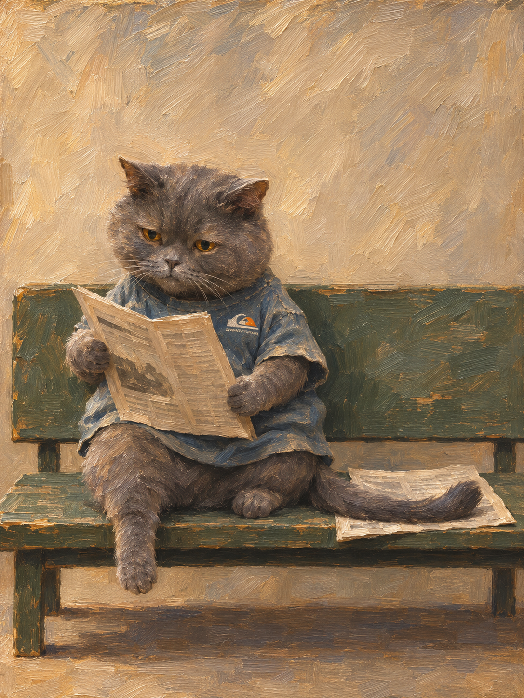
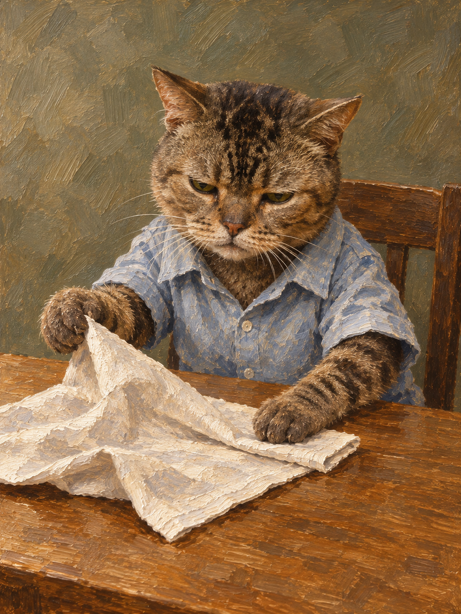
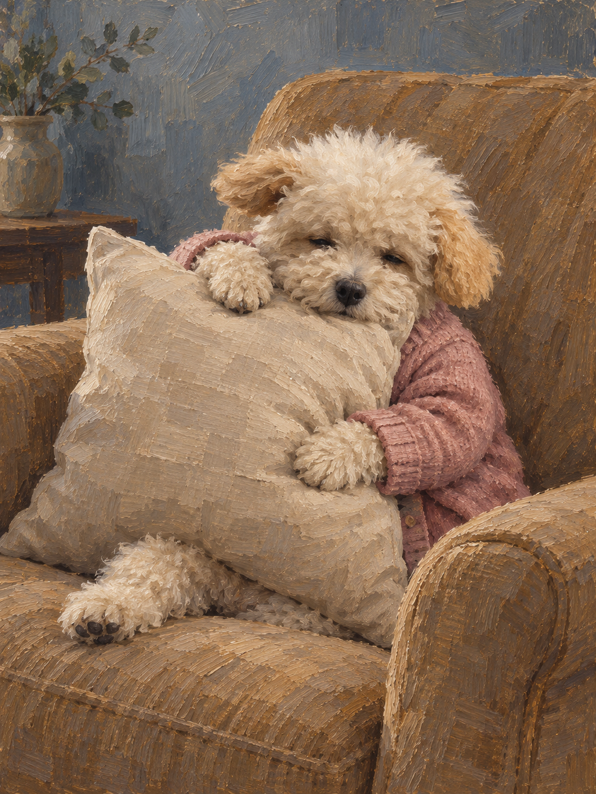

<div align="center">

# Lafiteskill

**把真实猫狗重新塑造成油画里的人物：保留它的个体特征，让表情、持身、衣服和日常小事共同形成性格。**

<sub>一个面向 Codex 内置 Imagegen 的宠物人物创作 Skill。名字来自拉菲，一只蓝灰色的猫。</sub>

<br>
<br>


[](examples/real-cases/README.md)
[](LICENSE)

[30 秒看懂](#30-秒看懂) · [作品示例](#作品示例) · [快速开始](#快速开始) · [处理方式](#它怎样设计一个人物) · [运行边界](#运行边界)

</div>

---

## 30 秒看懂

| 你提供什么 | Skill 会重点处理什么 |
| --- | --- |
| 一张猫或狗的照片 | 找出脸颊、耳形、眼鼻口、毛色和体态的个体组合，允许用绘画重构。 |
| 一个日常活动 | 让身体、爪、道具和注意力互相影响，形成“它正在做事”的人物感。 |
| 没有服装想法 | 比较两套用途或轮廓不同的衣物，让领袖、松量和下摆参与角色。 |
| 一张角色草图 | 核对轮廓、姿态、遮挡和支撑；草图不取代真实宠物身份。 |
| “这张认可，只改衣服” | 保护已认可的脸、姿态与生活关系，再做限定范围的编辑。 |
| “先做设计，不生成” | 交付人物方案、参考职责和请求草案，保持零调用。 |

核心流程：

```text
真实宠物照片
→ 找到个体身份特征
→ 设计表情、整体轮廓与日常行为
→ 选择衣物，检查接触、遮挡和支撑
→ 区分身份 / 结构 / 绘画质量参考
→ 组装完整提示词，按授权数量生成
→ 看实际画面，分别记录视觉评审和用户认可
```

---

## 作品示例

### 拉菲：看报，也占了旁边的位置



<sub>真实用户认可的最终图。照片身份、看报姿态与尾巴占位共同形成角色；冲浪衫只是这张图的选择，不是通用默认。[来源与认可记录](assets/approved/manifest.json)。</sub>

### 不同主体与生活状态

| 虎斑猫 · 把餐巾理平 | 奶油犬 · 抱着靠垫歇一会儿 |
| --- | --- |
|  |  |
| 两爪分别提住与抹平餐巾，前倾身体和蓝衬衫随动作变化。[完整记录](examples/real-cases/tabby-napkin/README.md) | 小身体陷进大椅，头和爪靠着大靠垫，开衫参与休息状态。[完整记录](examples/real-cases/cream-dog-cushion/README.md) |

三张均获用户明确认可。两张新主体是 1.29.0 的真实历史运行，每例一次；本次只整理记录，没有重新生成。它们提供有限的猫狗迁移证据，不能据此给出稳定成功率，也不代表其余测试全部通过。

[真实文件回放与证据边界](examples/real-cases/README.md) · [交互回放页](examples/real-cases/gallery.html)

---

## 快速开始

### 安装

需要能够查看图片并调用内置 Imagegen 的 Codex 环境；无需为这个 Skill 单独配置 API key，正式绘画仍使用宿主的图像额度。其他 Agent 的图像参考适配尚未实测。

仓库发布后，首次安装：

```bash
git clone https://github.com/mumuysd/lafiteskill.git "$HOME/.codex/skills/lafiteskill"
```

目标目录已经存在时，`git clone` 会停止。下载本地仓库后，也可以用 `python3 scripts/install_local.py --target ~/.codex/skills/lafiteskill` 安装；已有目录不会被覆盖。安装后在新一轮对话使用 Skill。

### 从照片开始

上传一张猫或狗的照片，然后说：

```text
请用 Lafiteskill 把这只宠物设计成一个有自己生活的油画人物。
保留它的个体特征，先给我看人物与服装设计；我确认后只生成一张。
```

已有想法时直接补充，例如：“它正在整理桌上的信件，目光看信，不看镜头。”用户指定的活动、视线、衣物或不穿衣优先。

### 先研究或只要提示词

明确说“先做人物设计，暂时不生成”，或“只输出最终提示词”。Skill 会停在指定阶段，不自动追加正式绘画、编辑或重试。

---

## 它怎样设计一个人物

| 环节 | 重点 |
| --- | --- |
| 个体身份 | 保留脸、耳、眼鼻口、毛色和体态的组合；不只保留物种与颜色。 |
| 人物轮廓 | 头、肩、衣体、爪、后躯与物件共同设计，不先完成猫脸再套衣服。 |
| 生活反差 | 用动作、尺度和动物身体限制产生意味，不靠“可爱”“严肃”等形容词代替设计。 |
| 衣物选择 | 比较用途与轮廓；领口、袖口、松量和下摆随姿态变化，不固定复古背心或冲浪衫。 |
| 绘画组织 | 让明暗色形、转面、方向笔和边缘共同塑造体积；描绘程度服务人物。 |
| 实图评审 | 先整幅、再局部、再回整幅，检查身份、生活关系、绘画和身体空间。 |

参考职责：

| 输入 | 提供什么 |
| --- | --- |
| 用户照片 / identity | 真实宠物身份。 |
| 可选草图 / structure | 构图、轮廓、姿态、遮挡与支撑。 |
| 可选认可图 / quality | 已获认可的形色、体积、边缘和人物质量关系。 |

多图只是工具能力，不保证职责自动独立。认可图不负责覆盖新主体的脸，也不把所有样例一并塞入请求。[完整契约](references/prompt-assembly.md)。

---

## 功能地图

| 能力 | 产物 |
| --- | --- |
| 照片观察 | 个体特征、未知项与可重构范围。 |
| Character Plan | 脸部、整体轮廓、动作、物件与衣物的可见关系。 |
| 参考清单 | identity / structure / quality 职责、实际输入与 hash。 |
| 请求组装 | 完整 prompt、请求草案与追踪记录；脚本本身不调用服务。 |
| 正式绘画 | 按当前授权数量生成的图像文件。 |
| 评审与反馈 | 三个整体维度、七项局部检查，以及独立的用户认可。 |

## 运行边界

- 当前以单只猫狗为主要范围，其他动物、多人群像和其他运行环境没有同等验证。
- 允许油画重构，但不能丢掉宠物的个体身份，或把所有主体统一成大眼圆脸。
- 细毛、眼亮点、密织和厚笔可以成立；少细节也不自动代表概括成功，关键是它们怎样服务人物与体积。
- 不以断尾、穿纸、多肢或不可信承重换取幽默；被遮住的身体不作已经验证的宣称。
- 只按本轮数量授权生成。工具失败保存错误后停止，不自动重试或追加绘画编辑。
- 用户认可、视觉评审和技术检查分别记录。一个案例获认可不等于整个 Skill 已稳定。
- 原照片、研究原作复制图和私人请求不随包分发。使用图像服务处理照片前，服从用户的输入范围。

## 文件结构

```text
lafiteskill/
├── README.md
├── SKILL.md
├── style_profile.json
├── references/          # 人物设计、参考职责与验收
├── assets/approved/     # 原始认可视觉基准
├── examples/real-cases/ # 两例真实成图、原文 prompt 与脱敏记录
├── scripts/             # 离线安装、组装与包检查
└── tests/               # 离线接口回归，不调用图像服务
```

## 验证

运行检查需要 Python 3.10+，仅使用标准库：

```bash
PYTHONDONTWRITEBYTECODE=1 python3 scripts/check_package.py
PYTHONDONTWRITEBYTECODE=1 python3 -m unittest discover -s tests -v
```

测试覆盖版本、参考职责、hash、衣物例外、视线、相对路径及安装后组装。它们证明接口可用，不替代艺术判断。历史案例的完整 prompt 与成图原样保存；实际请求只替换私人路径，原照片不公开。[验收说明](references/acceptance.md)。

## 许可与来源

代码和说明文字使用 [MIT License](LICENSE)。示例图单独见[图像资产使用说明](assets/ASSET-LICENSE.md)，MIT 不授予图像、商标或第三方权利的通用复用许可。

人物研究参考 [Alison Friend 在 Harman Projects 的作品](https://www.harmanprojects.com/exhibitions/67-alison-friend-while-you-were-out/)，学习动物形、日常关系和绘画取舍；本项目与艺术家无合作或背书关系，原作复制图不分发。
