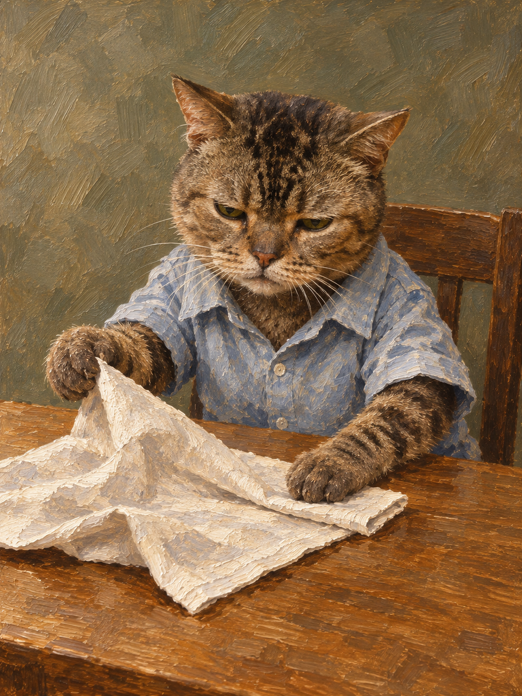

# 虎斑猫 · 把餐巾理平

用户已认可，实际生成版本 1.29.0，每例调用一次。本次仅整理，不生成。

[身份/职责与时间记录](case.json) · [原文 prompt](prompt.txt) · [设计计划](character-plan.json) · [形色空间](composition-intent.json) · [脱敏请求](request-redacted.json) · [原视觉评审](visual-review.json)

原文 prompt 和成图逐字节保留。请求里的本机图片路径替换为明确占位路径，真实照片不随包分发；不要把这个脱敏副本当原始请求的同字节文件。原始请求 hash 单独保留，完整原件在本地研究侧。

剩余问题：毛面、衣物与餐巾仍有丰富细纹，后续应观察是否争夺注意力；画外后腿不作通过宣称。

图片单独见[资产使用说明](../../../assets/ASSET-LICENSE.md)。
